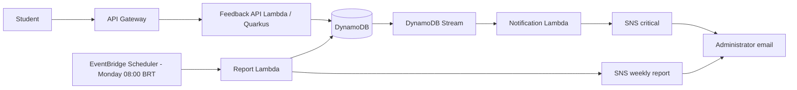

# Serverless Feedback Platform

FIAP Tech Challenge backend for student feedback: students submit evaluations, critical feedback notifies administrators, and a weekly report is emailed.



## Modules

- `shared`: domain, urgency classifier, reporting period and renderer.
- `feedback-api`: Quarkus HTTP Lambda with `POST /avaliacao`.
- `notification-lambda`: DynamoDB Streams Lambda.
- `report-lambda`: EventBridge scheduled Lambda.

Each SAM resource maps to a separate generated artifact and handler; three classes in a single deployment package would not satisfy that boundary.

## Data design

DynamoDB stores `pk=EVALUATION`, `sk=<UTC timestamp>#<id>`, description, grade, urgency and timestamp. `ReportWeekIndex` uses Monday's São Paulo date as partition key and `sk` as sort key, allowing report queries without table scans.

## Local development

Requires Java 21 and Maven. AWS CLI/SAM CLI are required only for cloud validation/deployment.

```powershell
mvn verify
mvn package
cd feedback-api; mvn quarkus:dev
Invoke-RestMethod -Method Post -Uri http://localhost:8080/avaliacao -ContentType application/json -Body '{"descricao":"Audio da aula cortando","nota":2}'
```

The API returns `201` for valid input, `400` for invalid/missing fields, and `500` for unexpected persistence errors without stack traces. Real local persistence needs standard AWS credentials, `AWS_REGION`, and `FEEDBACK_TABLE_NAME`; tests do not need AWS.

## AWS, security and monitoring

`template.yaml` defines API Gateway, DynamoDB/stream, SNS, three Java 21 Lambdas, a Monday 08:00 `America/Sao_Paulo` ScheduleV2 trigger and CloudWatch Lambda-error alarms. DynamoDB is on-demand and encrypted at rest. Policies limit Feedback to table write, Report to table/index query and its topic publish, and Notification to its topic publish.

Maven creates the three Lambda artifacts before SAM runs. Their SAM resources use `Metadata: SkipBuild: true`, so `sam build` copies the prebuilt Quarkus ZIP and shaded Java JARs instead of treating an artifact JAR as a Maven source directory.

The API deliberately has no authentication for the academic demo. Add an authorizer before public exposure. Review Lambda logs, Errors/Duration and stream iterator age in CloudWatch. Costs may arise from Lambda, API Gateway, DynamoDB, SNS, EventBridge and CloudWatch; configure AWS Budgets and delete the stack after the demonstration.

## Manual deployment

```powershell
mvn package
sam validate --template template.yaml
sam build --template-file template.yaml
sam deploy --guided --parameter-overrides AdministratorEmail=admin@example.com
```

Do not run deployment before review. Confirm both SNS subscription emails. The repository supplies no AWS credentials or personal email.

## CI/CD and FIAP delivery

`build.yml` verifies Maven and SAM. `deploy.yml` is `workflow_dispatch` only and uses GitHub OIDC (`AWS_DEPLOY_ROLE_ARN`, `AWS_REGION`, `ADMINISTRATOR_EMAIL`). Configure a narrowly scoped deploy role.

Before final submission, deploy manually and record: resources/functions, API request, DynamoDB item, critical email, weekly report, EventBridge schedule, CloudWatch logs/alarms, and SAM/GitHub configuration. No cloud behavior is claimed as verified until then.
